# 📊 Ciencia de Datos y Álgebra Lineal Computacional (Exactas - UBA)

Repositorio con proyectos prácticos desarrollados durante la **Licenciatura en Ciencias de Datos** en la **Facultad de Ciencias Exactas y Naturales (FCEN - UBA)**. Incluye análisis exploratorio de datos reales (SUBE, Fútbol Europeo, Inmuebles), modelos de Machine Learning supervisado y no supervisado, e implementaciones numéricas desde cero de Álgebra Lineal Computacional.

---

## ⚽ 1. Scouting, Clustering y Valuación en Fútbol Europeo (*Moneyball*)
📂 **Carpeta:** [`04-futbol-europeo-ml/`](./04-futbol-europeo-ml) — Notebook: [`futbol_europeo_ml_tp2.ipynb`](./04-futbol-europeo-ml/futbol_europeo_ml_tp2.ipynb)

Integración de bases de datos de rendimiento deportivo (**FBRef 2020-21**), valores de mercado (**Transfermarkt**) y **Superliga Femenina** para resolver tres problemas:

1. **Clustering No Supervisado de Posiciones (`K-Means` y `DBSCAN` + `PCA`)**:
   - Reducción de dimensionalidad con **PCA** y estimación del hiperparámetro $\varepsilon$ óptimo mediante la curva de distancias al $k$-ésimo vecino más cercano ($k$-NN).
   - Identificación automática de perfiles posicionales (arqueros vs. jugadores de campo y sub-clusters tácticos: defensores, mediocampistas y delanteros).
2. **Clasificación Supervisada (`KNN`)**:
   - Predicción de la posición en cancha alcanzando un **82.68% de exactitud (accuracy)** sobre las grandes ligas europeas y evaluación de transferencia del modelo a la Superliga Femenina.
3. **Sistema de Recomendación y Valuación de Mercado**:
   - **Búsqueda de reemplazos por similitud vectorial**: identificación de los jugadores estadísticamente más cercanos a **Lionel Messi** en el espacio de métricas avanzadas, recomendando a **Kai Havertz** por relación rendimiento/edad/costo.
   - **Detección de jugadores subvaluados y sobrevaluados**: modelo de regresión sobre el valor de mercado que detecta oportunidades de fichaje (identificando a **Marcus Thuram** como reemplazo subvaluado frente a **Kylian Mbappé**).

  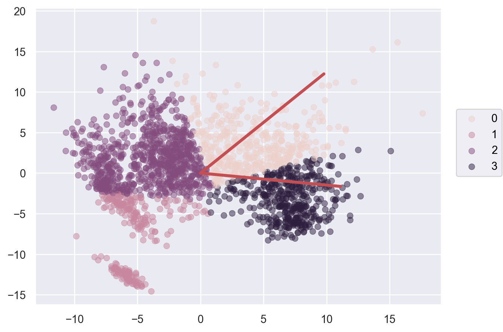
  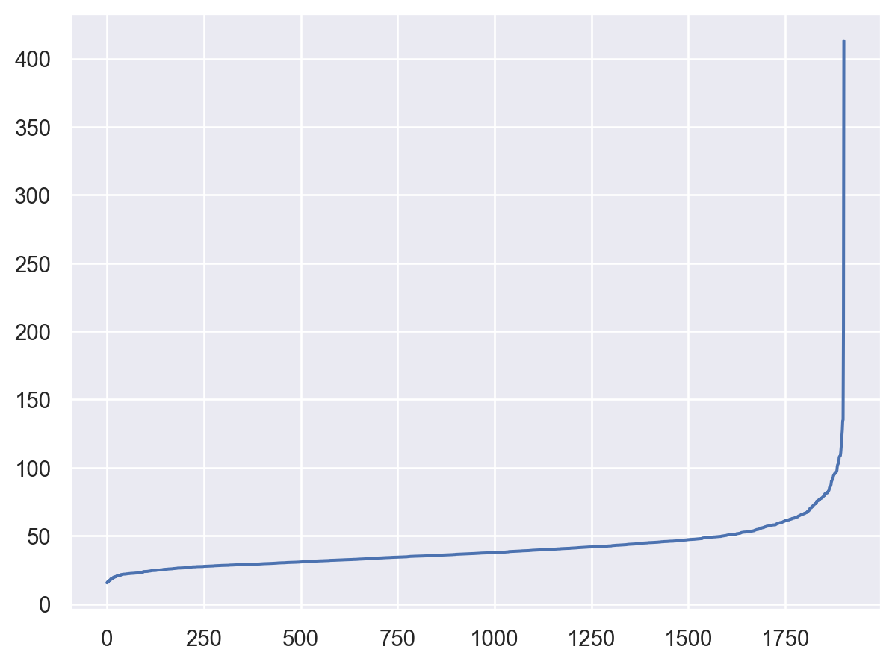

  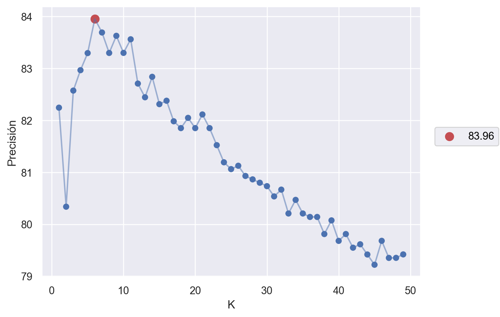
  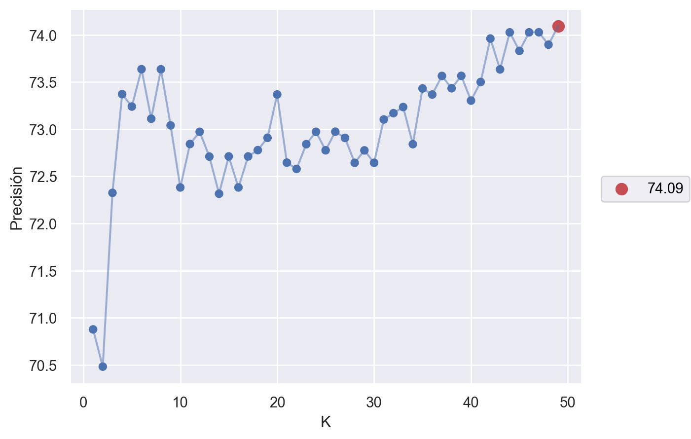

---

## 🚌 2. Análisis del Transporte Público en Argentina (Datos SUBE 2021–2023)
📂 **Carpeta:** [`03-laboratorio-datos-tp1/`](./03-laboratorio-datos-tp1) — Notebook: [`analisis_exploratorio_tp1.ipynb`](./03-laboratorio-datos-tp1/analisis_exploratorio_tp1.ipynb)

Procesamiento, visualización y modelado predictivo sobre millones de registros diarios de viajes del sistema **SUBE**:

- **Procesamiento y Limpieza (`Pandas`)**: Transformación a formato *tidy*, cruce de datos geográficos (**AMBA vs. Interior**) y desagregación por medio de transporte (colectivo, tren, subte).
- **Análisis Exploratorio y Hallazgo Electoral (`Seaborn` / `Matplotlib`)**:
  - Análisis de estacionalidad y detección de anomalías: se descubrió que las mayores caídas históricas de viajes durante 2023 coincidieron exactamente con los **domingos de elecciones nacionales (PASO, Generales y Ballotage)**, contrastándolos estadísticamente contra el promedio de los domingos normales del año.
- **Selección de Variables y Regresión Regularizada (`XGBoost`, `Random Forest`, `Ridge`)**:
  - Selección de las 5 líneas de colectivo con mayor poder predictivo sobre la **Línea 009** utilizando tres enfoques: correlación directa, `SelectKBest` + `RandomForestRegressor` e importancia de variables con **XGBoost**.
  - Entrenamiento y evaluación mediante **Validación Cruzada (`KFold`)** de modelos lineales y regularizados (**Ridge** con ajuste de hiperparámetro $\alpha$ vía `Formulaic` y `Scikit-Learn`).

  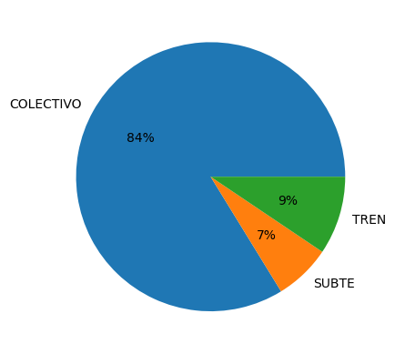
  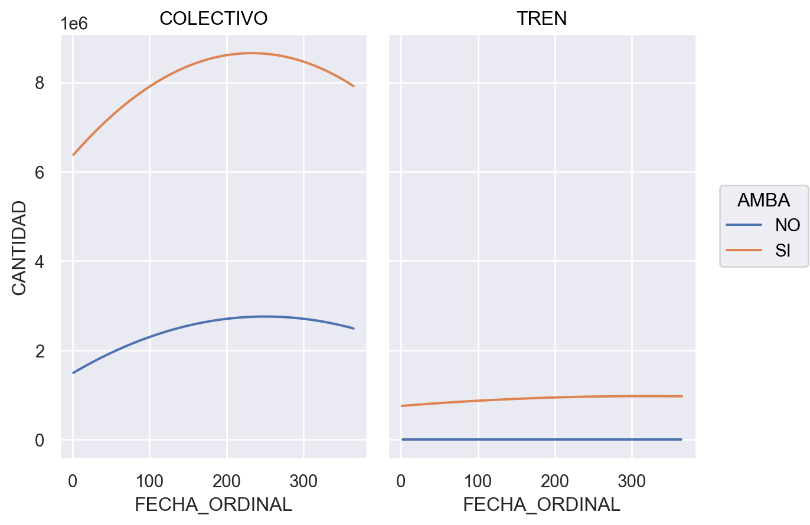

  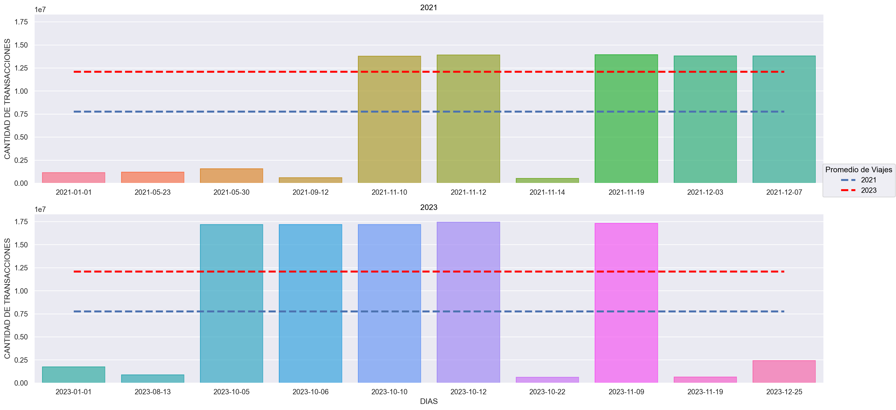
  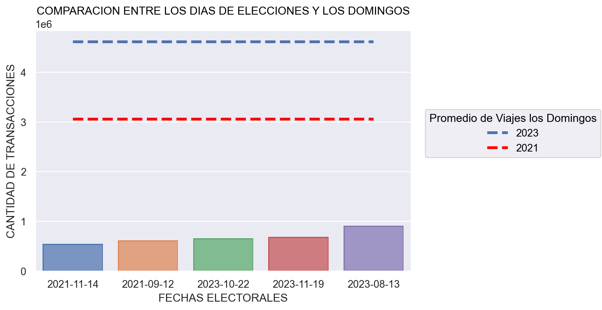

---

## 🕸️ 3. Algoritmo PageRank mediante Descomposición $LU$ desde Cero
📂 **Carpeta:** [`01-pagerank-lu/`](./01-pagerank-lu) — Código: [`funciones.py`](./01-pagerank-lu/funciones.py) · Notebook: [`pagerank_lu_tp1.ipynb`](./01-pagerank-lu/pagerank_lu_tp1.ipynb)

Implementación numérica desde cero del algoritmo **PageRank** para rankear nodos en redes dirigidas:
- Planteo del sistema lineal $(I - p W D) x = e$ a partir de la matriz de adyacencia de la red.
- Implementación propia de **Eliminación Gaussiana con pivoteo parcial** y factorización $PA = LU$ (`escalonar_matriz`, `separar_matriz`, `desc_lu`).
- Resolución exacta mediante sistemas triangulares (`scipy.linalg.solve_triangular`) y análisis de complejidad temporal y sensibilidad frente al factor de amortiguamiento $p \in (0, 1)$.

  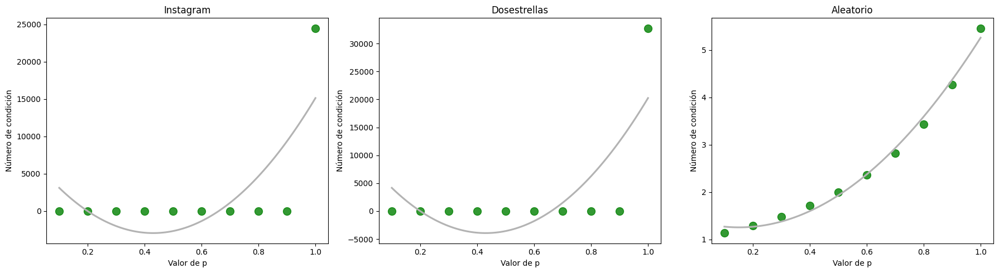
  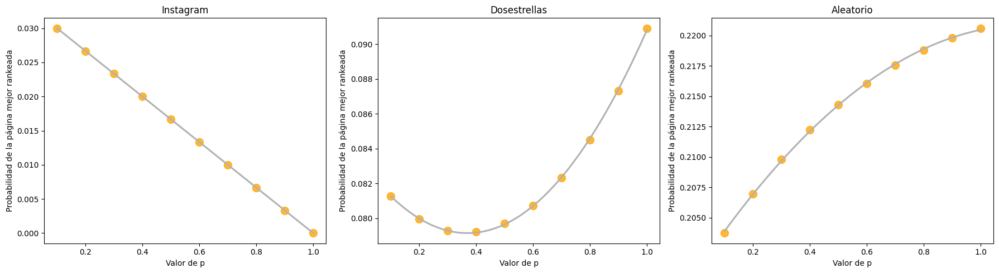

---

## 🖼️ 4. Reconocimiento y Compresión con PCA, SVD y Cuadrados Mínimos
📂 **Carpeta:** [`02-pca-reconocimiento-imagenes/`](./02-pca-reconocimiento-imagenes) — Notebooks: [`pca_tp2.ipynb`](./02-pca-reconocimiento-imagenes/pca_tp2.ipynb) · [`pca_irl.ipynb`](./02-pca-reconocimiento-imagenes/pca_irl.ipynb) · [`minimos_cuadrados.ipynb`](./02-pca-reconocimiento-imagenes/minimos_cuadrados.ipynb)

- **Análisis de Componentes Principales (PCA)**: Cálculo de autovalores y autovectores dominantes mediante el **Método de la Potencia y Deflación**, proyección al subespacio de componentes principales y reconstrucción/compresión de imágenes analizando la varianza explicada acumulada.
- **Cuadrados Mínimos**: Ajuste de curvas y superficies mediante factorización QR y Descomposición en Valores Singulares (SVD).

  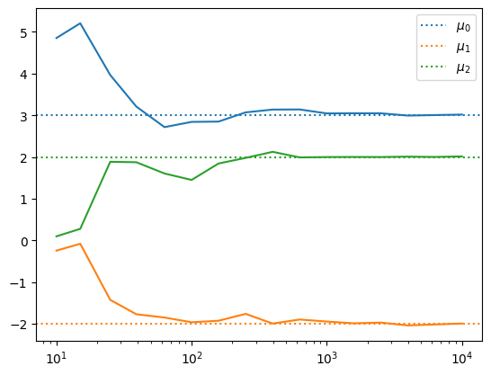
  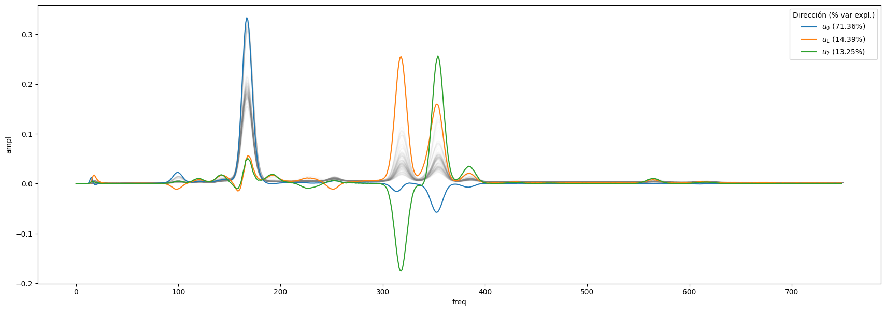

---

## 📐 5. Regresión Ridge, Cadenas de Markov y Punto Flotante
📂 **Carpeta:** [`05-regresion-markov-punto-flotante/`](./05-regresion-markov-punto-flotante)

- **[`ridge_regression.ipynb`](./05-regresion-markov-punto-flotante/ridge_regression.ipynb)**: Regularización $L_2$ (Ridge) y compromiso sesgo-varianza.
- **[`visualizacion_inmuebles_outliers.ipynb`](./05-regresion-markov-punto-flotante/visualizacion_inmuebles_outliers.ipynb)**: Análisis de precios de inmuebles y tratamiento de outliers.
- **[`cadenas_markov_absorcion.py`](./05-regresion-markov-punto-flotante/cadenas_markov_absorcion.py)**: Simulación de Monte Carlo y matrices de transición para estados absorbentes.
- **[`aritmetica_punto_flotante.ipynb`](./05-regresion-markov-punto-flotante/aritmetica_punto_flotante.ipynb)**: Estudio de precisión numérica IEEE 754, épsilon de máquina y propagación de errores.

---

## 🛠️ Stack
`Python` · `Pandas` · `NumPy` · `SciPy` · `Scikit-Learn` · `XGBoost` · `Formulaic` · `Matplotlib` · `Seaborn` · `NetworkX`
